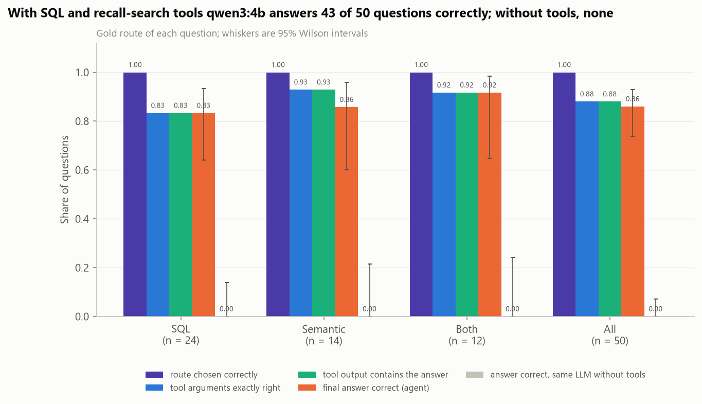
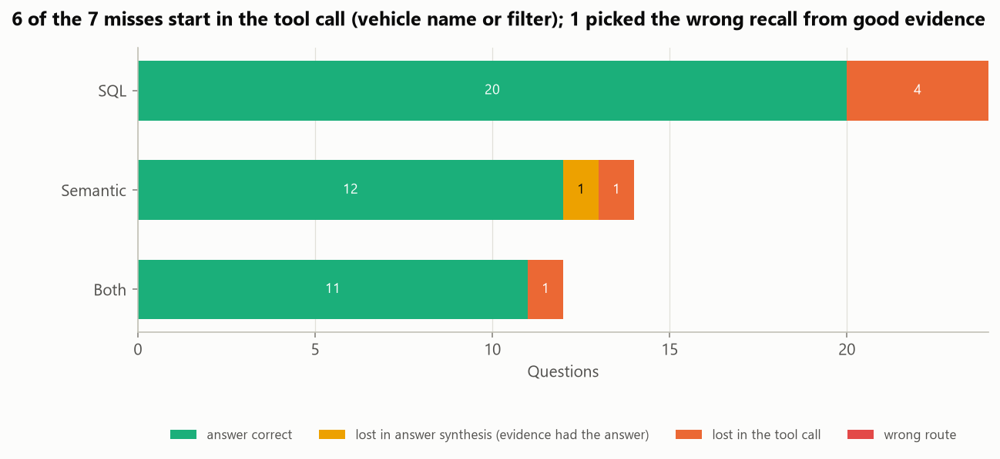
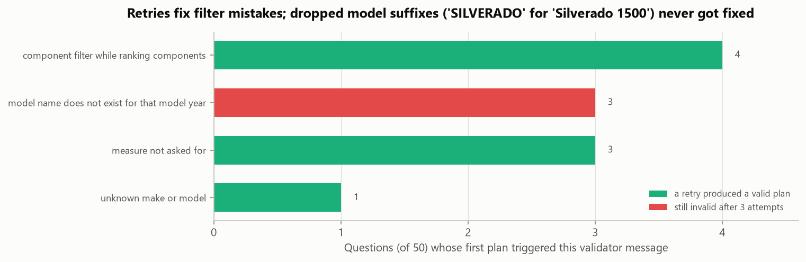
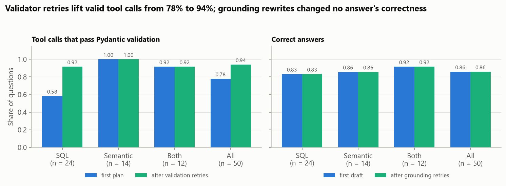
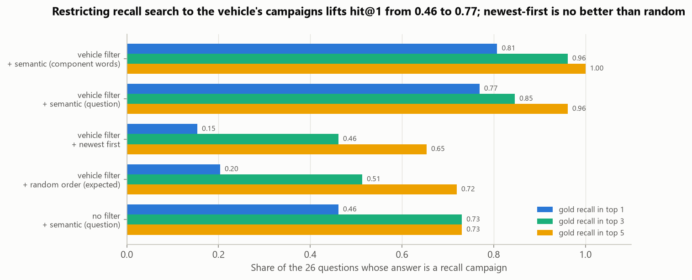
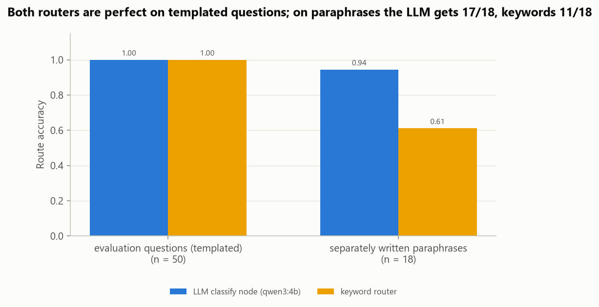
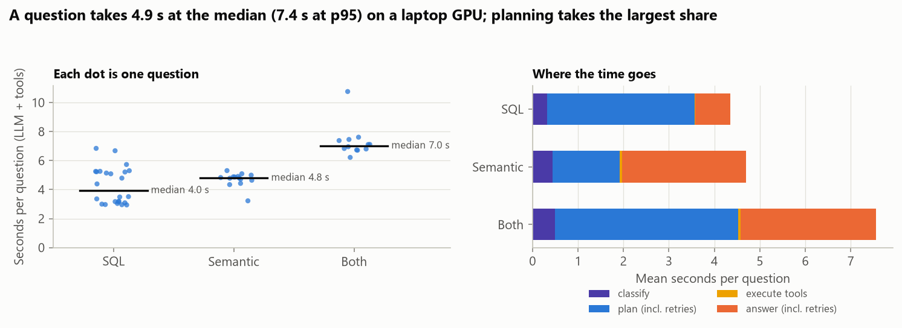

# LangGraph Agent for Vehicle Safety Intelligence

**Can a small local LLM answer vehicle-safety questions correctly if SQL and search supply the facts and the LLM
only plans and writes?** This project builds a LangGraph agent over NHTSA's public complaint and recall data and
tests it on 50 questions whose gold answers come from SQL.

It mirrors the agent work of an engineering-intelligence team: a safety analyst, fleet manager or quality engineer
asks *"How many complaints about the brakes of the 2024 Toyota Tacoma has NHTSA received, and is there a recall that
covers this problem?"* and needs a number they can trust plus the recall that explains it. The agent routes the
question, calls Pydantic-validated tools (parameterised DuckDB SQL, FAISS search over recall summaries), cites every
fact, checks its own answer against the evidence, and retries when a check fails. It runs on a laptop with
`qwen3:4b` through Ollama; OpenAI or Azure OpenAI can be switched in through environment variables but are never
needed.



## Key findings

| Question | Baseline | Agent | Validation |
|---|---|---|---|
| Answer accuracy, 50 test questions | same LLM without tools: **0 / 50** | **43 / 50** (0.86, 95% CI 0.74-0.93) | gold answers from independently written gold SQL; exact McNemar p < 1e-12 |
| Tool calls valid (Pydantic + argument checks) | first plan: 39 / 50 | **47 / 50** after validator-guided retries | every validator message logged |
| Recall search: gold campaign ranked first | whole corpus: 0.46 | **0.77** with the vehicle filter | 26 questions, 5 strategies, no LLM |
| Routing (sql / semantic / both) | keyword router on paraphrases: 11 / 18 | **17 / 18** on paraphrases (50 / 50 on the templates) | 18 separately written paraphrases |

1. **Tools are what make the small model useful.** With SQL and recall search, `qwen3:4b` answers 43 of 50 questions
   correctly (SQL questions 20 / 24, semantic 12 / 14, both 11 / 12). Without tools it answers none: it either says
   it has no access to the data or gives a wrong count, a recall number that does not exist ("22001") or a recall
   description for the wrong problem.
2. **Validator messages repair most bad tool calls.** The first plan was invalid for 11 questions: a component filter
   on a ranking, `potential_units` for "how many recall campaigns", an unknown model name. Feeding the validator's
   messages back fixed 8 of them; on SQL questions valid plans rose from 14 / 24 to 22 / 24.
3. **The remaining errors are about vehicle names.** 6 of the 7 misses start in the tool call. Three times the
   model wrote `SILVERADO` / `SIERRA` for "Silverado 1500", "Sierra 1500" and "Silverado 3500"; it kept doing so after
   the validator listed the right model, and the agent declined. Two more resolved to a real but wrong vehicle
   (`F-150` for "F-150 Hybrid", make `HYUNDAI` for "Genesis GV70"), and one added an unrequested `MODEL Y` filter. In
   total 4 answers (8%) state something wrong and 3 (6%) are abstentions.
4. **The grounding check catches garbled output, not wrong evidence.** It flagged 2 of 47 drafts, both with a
   corrupted "F-15:0" for "F-150", and the rewrite fixed the text. It passed the three wrong drafts that faithfully
   reported evidence for a slightly different question, so first-draft and final accuracy are the same (0.86).
5. **For recall search, the vehicle filter matters more than the query.** Restricting FAISS to the vehicle's
   campaigns lifts hit@1 from 0.46 to 0.77 (0.81 with only the component words as query). Listing a vehicle's recalls
   newest first is no better than random order (hit@1 0.15 vs 0.20).
6. **A question takes 4.9 s at the median** (7.4 s at p95, 3.3 LLM calls) on a laptop RTX 4050; planning, including
   retries, takes the largest share, and SQL and FAISS take milliseconds.

The database was checked against the live API first: for the 20 vehicles in the test questions, recall campaign
sets match `api.nhtsa.gov` for all 19 the API answered, and complaint counts match for 17 of 18
([`api_crosscheck.csv`](reports/results/api_crosscheck.csv)). The exception, the 2017 Chevrolet Bolt EV, is an API-side
gap: the API lists 6 of the 53 complaints in the flat file and none filed in 2024-2025.

## Results

### What the agent does with one question

From the in-process API check ([`api_smoke.json`](reports/results/api_smoke.json)), a `both` question from the test
set:

> **Q:** How many complaints about the fuel system of the 2018 Alfa Romeo Giulia has NHTSA received, and is there a
> recall that covers this problem?
>
> **A:** NHTSA received 6 complaints about the fuel system of the 2018 Alfa Romeo Giulia. There is a recall covering
> this problem: Campaign 25V586000 for 2017-2019 Alfa Romeo Giulia and 2018-2019 Alfa Romeo Stelvio vehicles. The
> fuel pump may fail, causing loss of drive power and increased crash risk. Dealers will replace the fuel delivery
> module free of charge. *(citations: S1, 25V586000)*

Behind it: route `both`; one `StatsQuery` (complaints, make ALFA ROMEO, model GIULIA, model year 2018, component
FUEL SYSTEM) compiled to one SQL query, and one `RecallSearch` restricted to the 2018 Giulia's campaigns; both calls
passed validation on the first plan, and the draft passed the grounding check. The full trace of every test
question (tool calls, SQL, evidence, every draft and validator message) is in
[`agent_traces.jsonl`](reports/results/agent_traces.jsonl).

### Where questions are lost



Each question is attributed to the first stage that lost it ([`agent_results.csv`](reports/results/agent_results.csv)).
Tool arguments were exactly right for 44 of 50 questions, the evidence contained the gold answer for exactly those
44, and the answer was right for 43 of them. The one synthesis miss is the 2021 Cadillac Escalade electrical-system
question: the gold recall was the third search hit, and the answer described the first, a fuel-pump module recall.

### Validation and retries



| | SQL (24) | Semantic (14) | Both (12) | All (50) |
|---|---:|---:|---:|---:|
| Tool calls valid on the first plan | 0.58 | 1.00 | 0.92 | 0.78 |
| ... after validator-guided retries (max 3 plans) | 0.92 | 1.00 | 0.92 | 0.94 |
| Tool arguments exactly equal to the gold filters | 0.83 | 0.93 | 0.92 | 0.88 |
| Answer correct, first draft | 0.83 | 0.86 | 0.92 | 0.86 |
| Answer correct, after grounding retries (max 3 drafts) | 0.83 | 0.86 | 0.92 | 0.86 |
| Same LLM without tools | 0.00 | 0.00 | 0.00 | 0.00 |

<sub>[`summary_by_route.csv`](reports/results/summary_by_route.csv), [`plan_validation_errors.csv`](reports/results/plan_validation_errors.csv),
[`grounding_check.csv`](reports/results/grounding_check.csv), [`comparisons.csv`](reports/results/comparisons.csv).</sub>



Validator messages work when they name the fix ("use 'count' to count complaints or recall campaigns", "do not filter
on a component when ranking by component"). They did not work when the fix was to copy a longer model name: the
message listed `SILVERADO 1500` among four candidates and the model wrote `SILVERADO` again on every retry.

### Recall search



The 26 semantic and both questions have recall campaigns as gold answers; each strategy ranks the candidate campaigns
without the LLM ([`retrieval_summary.csv`](reports/results/retrieval_summary.csv)). The vehicles have 3 to 29
campaigns (median 8), so the filter does most of the work, and semantic ranking within the vehicle puts the right one
first about four times out of five.

| Strategy | hit@1 | hit@3 | hit@5 |
|---|---:|---:|---:|
| Vehicle filter + semantic (component words only) | **0.81** | **0.96** | **1.00** |
| Vehicle filter + semantic (whole question; what the agent does) | 0.77 | 0.85 | 0.96 |
| Vehicle filter + newest first | 0.15 | 0.46 | 0.65 |
| Vehicle filter + random order (expected) | 0.20 | 0.51 | 0.72 |
| No filter + semantic (whole question) | 0.46 | 0.73 | 0.73 |

### Routing



The templated test questions do not challenge routing: the LLM classify node and a keyword router are both perfect.
On 18 separately written paraphrases ("Tally the recall campaigns for the 2017 Nissan Rogue", "Owners of the 2020 Chevy Bolt
keep complaining about the battery - how many complaints are there, and has GM recalled it for that?") the LLM routes
17 correctly and the keyword router 11 ([`routing.csv`](reports/results/routing.csv)).

### Latency



Latency is the model time of each LLM call, measured when the call was made and stored with the cached reply, plus
tool time ([`latency_by_route.csv`](reports/results/latency_by_route.csv)). Median 4.0 s for SQL questions, 4.8 s for
semantic and 7.0 s for both. Called directly, the SQL tool endpoint takes 10 ms and the recall-search endpoint 45 ms
(median, CPU query encoder).

## Data

| | |
|---|---|
| Recalls | NHTSA `FLAT_RCL_POST_2010.zip` from [static.nhtsa.gov/odi/ffdd/rcl](https://static.nhtsa.gov/odi/ffdd/rcl/), file dated 2026-10-10: 13,673 vehicle recall campaigns reported 2010-01-01 to 2026-10-06, covering 93,365 campaign-vehicle (make, model, model year) rows |
| Complaints | NHTSA `COMPLAINTS_RECEIVED_2025-2026.zip` from [static.nhtsa.gov/odi/ffdd/cmpl](https://static.nhtsa.gov/odi/ffdd/cmpl/), file dated 2026-10-09: 135,048 vehicle complaints received 2025-01-01 to 2026-10-07 |
| Cross-check | [api.nhtsa.gov](https://api.nhtsa.gov) `recallsByVehicle` and `complaintsByVehicle` (no key) |
| License | U.S. government works (NHTSA Office of Defects Investigation), public domain |

Only vehicle records are loaded (recall type `V`, complaint product type `V`), into five DuckDB tables: `recalls`,
`recall_vehicles`, `recall_components`, `complaints`, `complaint_components`. Fields that the agent does not need and
that can identify people (city, partial VIN, dealer, vehicle operator name, complaint narrative) are never read. The
downloads (56 MB zipped) stay in `data/raw/` and are not redistributed; their sha256 hashes are in
[`run_metadata.json`](reports/results/run_metadata.json). NHTSA does not verify complaints, so complaint counts
measure reports, not defect rates.

NHTSA uses two overlapping component taxonomies (complaints say `ENGINE`, recalls `ENGINE AND ENGINE COOLING`), so
component names are mapped to 31 families by longest prefix (`safetyagent/data.py`).

Models: [`qwen3:4b`](https://ollama.com/library/qwen3) through Ollama (Apache-2.0) and
[`BAAI/bge-small-en-v1.5`](https://huggingface.co/BAAI/bge-small-en-v1.5) (MIT) for recall embeddings.

## Method

### The graph

```
            +-----------+     +--------+  invalid calls, < 3 attempts
question -> | classify  | --> |  plan  | <-------------------------+
            +-----------+     +--------+ --------------------------+
             sql/semantic/both    | valid calls         | still invalid after 3 attempts
                                  v                     v
                             +---------+           +---------+
                             | execute |           | decline | -> END
                             +---------+           +---------+
                                  v
                             +---------+  grounding problems, < 3 drafts
                             | answer  | <------------------------------+
                             +---------+                                |
                                  v                                     |
                         +-----------------+ ---------------------------+
                         | check_grounding | -> END (cited answer)
                         +-----------------+
```

- **classify** asks the LLM for a route: `sql` (counts, totals, rankings), `semantic` (what a recall is about) or
  `both`. If the reply is not a valid route, the keyword router takes over.
- **plan** asks for tool calls in a JSON schema that only offers the route's tools. The LLM never writes SQL; it
  fills one of two Pydantic models:
  - `StatsQuery` (dataset, measure, make, model, model year, component family, calendar year, crash / fire /
    do-not-drive flags, optional group-by), compiled into one parameterised DuckDB query that counts each complaint or
    campaign once (`SELECT count(*) FROM (SELECT DISTINCT uid, ...)`), so a campaign covering three models, or a
    complaint listing two brake components, is not double counted.
  - `RecallSearch` (a plain-language query plus an optional vehicle), answered by cosine search in a FAISS
    `IndexFlatIP` over BGE-small embeddings of each campaign's components, defect and consequence summaries,
    restricted with an `IDSelectorBatch` to the campaigns that cover the vehicle.
- **Validation** has two layers; every message goes back to the LLM in a retry prompt that shows the rejected calls
  (at most 3 plans):
  1. *Schema and vocabulary* (Pydantic, with the database vocabulary as validation context): a known make, model and
     component family (punctuation-insensitive matches such as `F150` -> `F-150` are fixed silently, other values get
     the closest valid ones), a vehicle that exists in that model year (`2025 TOYOTA SIENNA` -> "set model to SIENNA
     HYBRID"), a calendar year inside the data, and measures and flags that fit the dataset.
  2. *Argument grounding* against the question: a year argument must appear in the question, and the one year the
     question names must be used; crash, fire and do-not-drive flags and the injuries / deaths / units measures need a
     matching word in the question; a component filter needs a word from that family's name or gloss (with the
     vehicle's own name removed, so "Sienna Hybrid" is not a propulsion question), and a component word in the
     question needs a component filter.
- **execute** runs the calls and turns the output into evidence blocks with ids: `[S1]` for a statistics result,
  the campaign number (e.g. `[25V586000]`) for each recall.
- **answer** drafts `{"answer", "citations"}` from the evidence only. **check_grounding** requires that the answer
  cites at least one evidence id and only ids that exist, that every number in it occurs in the evidence or the
  question, and that every statistics result is actually stated. Problems go back for a rewrite (at most 3 drafts).
- **decline**: if no valid tool call remains after 3 plans, the agent says so instead of answering without evidence.

All LLM calls use Ollama structured outputs (`format` = JSON schema), temperature 0, seed 0 and an 8k context (the
model's default context made Ollama try to allocate a 37 GB KV cache). The local `qwen3:4b` tag is the
Thinking-2507 build, whose chat template always opens a `<think>` block; with `think: false` and a JSON schema the
constrained decoder writes the JSON directly, which keeps a plan call near 2 seconds. Every field of the tool-call
schema is required (nullable): with optional fields Ollama's grammar only accepts properties in schema order, and on
development questions the model wrote `component` right after `model`, skipping `model_year`, after which it could
not add it any more.

### Evaluation

- **Questions.** 50 test questions from 9 templates ([`eval_set.csv`](reports/results/eval_set.csv)): 24 `sql`
  (complaints about a vehicle, complaints about a vehicle's component, its most-complained-about component, a make's
  2025 complaints reporting a fire or a crash, recall campaigns covering a vehicle, vehicles potentially affected by a
  make's 2025 recalls), 14 `semantic` (why a vehicle was recalled over a component, with defect, risk and remedy) and
  12 `both` (complaints about a vehicle's component and the recall that covers it). Components are named in plain
  words ("rearview camera", "transmission", "body structure"). Vehicles are drawn at random (seed 1) from vehicles
  with enough complaints or recalls.
- **Gold answers** come from gold SQL written separately from the agent's SQL compiler
  (`safetyagent/evalset.py`, `GOLD_SQL`), and a unit test checks that the two agree on a synthetic database.
- **Development vs test.** Prompts and validation rules were developed on 9 questions from a separate development
  set (seed 0, disjoint vehicles); the 50 test questions were run once at the end.
- **Scoring.** SQL questions: the gold number (or component family) appears in the answer. Semantic: a gold campaign
  number is cited. Both: both conditions. Tool arguments are "exact" when a call's active filters equal the gold
  filters. Wilson intervals for proportions, exact McNemar tests for paired comparisons.
- **Baselines.** The same LLM without tools (closed-book, told the data's date coverage), a keyword router, and five
  recall-ranking strategies without the LLM.

## Validation and limitations

- **Templated questions.** The test questions come from 9 templates, so they exercise vehicle names, components and
  filters, not phrasing; routing is trivial on them. The 18 separately written paraphrases test routing only.
- **Small sample.** 50 questions give intervals of about +/-0.1 on accuracy; the per-route numbers (12 to 24
  questions) are rougher still.
- **Rules tuned on development questions.** The argument-grounding rules (cue words per component family, the "one
  year in the question" rule) were written after the development runs. They could reject unusual but valid phrasings,
  for example a question that names two years or uses "light" or "power" in another sense.
- **Gold labels measure faithfulness to the database**, not whether NHTSA's data are complete; the API cross-check
  covers 20 vehicles. Semantic answers are scored by the cited campaign number; the defect, risk and remedy text was
  read for the failures but not graded (no LLM judge, to stay within the compute budget).
- **Scope cut for low compute.** Complaints are limited to those received in 2025-2026 (the most recent NHTSA file) and
  recalls to those reported since 2010. One model, one seed, greedy decoding; the OpenAI and Azure adapters and
  LangSmith tracing are wired in but were not exercised (no keys are used).
- **Fixes not applied.** Resolving the vehicle from the question text before planning, for example preferring a
  validator suggestion that appears verbatim in the question, would likely recover the three declined Silverado / Sierra
  questions. It was identified on the test run, so it was left out rather than tuned on the test set.
- **Latency** is for one request at a time on a laptop GPU. LLM time is stored with each cached reply; tool time was
  measured in the final (cached) run.

## Reproduce

```bash
pip install torch --index-url https://download.pytorch.org/whl/cu128   # or the CPU build
pip install -r requirements.txt
ollama pull qwen3:4b                      # Ollama must be running on localhost:11434
python scripts/run_pipeline.py            # downloads ~56 MB once; about 6 min on a laptop RTX 4050 with an empty LLM cache
python scripts/run_pipeline.py --quick    # smoke test on 9 development questions: outputs go to data/cache/smoke/
python scripts/make_figures.py            # redraw figures from reports/results/
python scripts/api_smoke.py               # in-process API check (writes reports/results/api_smoke.json)
pytest
```

Every LLM reply is cached in `data/cache/llm_cache.sqlite` under a hash of the model, options, messages and schema,
together with its original latency; recall embeddings are cached under a hash of the campaign texts. A re-run only
calls the model for prompts it has not seen.

| Environment variable | Effect |
|---|---|
| `SAFETYAGENT_LLM` | `ollama` (default), `openai` or `azure` |
| `SAFETYAGENT_OLLAMA_MODEL`, `OLLAMA_HOST` | Ollama model (default `qwen3:4b`) and server |
| `SAFETYAGENT_OPENAI_MODEL`, `OPENAI_API_KEY` | OpenAI model and key (needs `pip install openai`) |
| `AZURE_OPENAI_ENDPOINT`, `AZURE_OPENAI_API_KEY`, `AZURE_OPENAI_DEPLOYMENT`, `OPENAI_API_VERSION` | Azure OpenAI |
| `LANGSMITH_TRACING=true`, `LANGSMITH_API_KEY` | optional LangSmith tracing of graph nodes and LLM calls |
| `SAFETYAGENT_DEVICE` | device of the API's query encoder (default `cpu`) |

### API

```bash
uvicorn app.main:app --port 8000        # Swagger UI at http://localhost:8000/docs
curl -X POST localhost:8000/ask -H "Content-Type: application/json" \
     -d '{"question": "How many complaints about the brakes of the 2024 Toyota Tacoma has NHTSA received, and is there a recall that covers this problem?"}'
curl -X POST localhost:8000/tools/stats -H "Content-Type: application/json" \
     -d '{"dataset": "complaints", "make": "toyota", "model": "camry", "model_year": 2018, "group_by": "component", "limit": 3}'
curl -X POST localhost:8000/tools/search -H "Content-Type: application/json" \
     -d '{"query": "rearview camera image does not display", "make": "FORD", "model": "F-150", "model_year": 2021}'
```

`/ask` returns the answer, route, citations, grounding status, tool calls, the SQL that ran and the evidence;
`/tools/stats` and `/tools/search` run the tools directly with the same validation (invalid arguments return HTTP 422
with the validator's messages). The service was verified in process with FastAPI's TestClient
([`api_smoke.json`](reports/results/api_smoke.json)).

## Project structure

```
safetyagent/
  data.py         NHTSA flat-file download, DuckDB tables, component families
  tools.py        Pydantic tool arguments, vocabulary and argument-grounding validation, SQL compiler
  search.py       BGE-small embeddings, FAISS index with vehicle filter
  llm.py          Ollama / OpenAI / Azure chat models with JSON schemas, SQLite reply cache, optional tracing
  prompts.py      prompts and JSON schemas for classify, plan, answer and the closed-book baseline
  agent.py        the LangGraph state machine (classify, plan, execute, answer, check_grounding, decline)
  grounding.py    citation and number checks
  router.py       keyword router (baseline and fallback)
  evalset.py      question templates, independently written gold SQL, routing paraphrases
  scoring.py      answer scoring, failure stages, Wilson and McNemar
  crosscheck.py   comparison with api.nhtsa.gov
  figures.py      all report figures
  plotting.py     shared colorblind-safe styling
app/              FastAPI + Pydantic service (/ask, /tools/stats, /tools/search)
scripts/          run_pipeline.py (everything), make_figures.py, api_smoke.py
notebooks/        analysis.ipynb, the walkthrough with tables and one full trace
reports/          figures/ and results/ (every number quoted above, plus all agent traces)
tests/            pytest suite with a synthetic database and a scripted fake LLM (SQL compiler vs gold SQL,
                  validation rules, graph routing and retries, grounding, scoring, data loading, cache, API)
```

## License

MIT; see [LICENSE](LICENSE). NHTSA data are U.S. government works in the public domain; models keep their own
licenses (qwen3 Apache-2.0, bge-small-en-v1.5 MIT).
